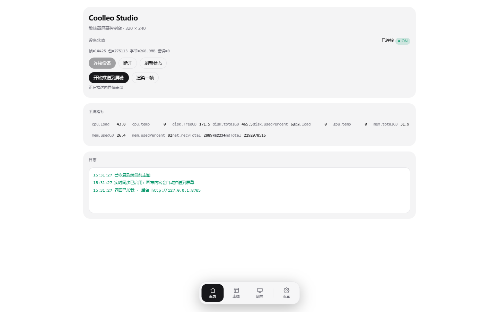
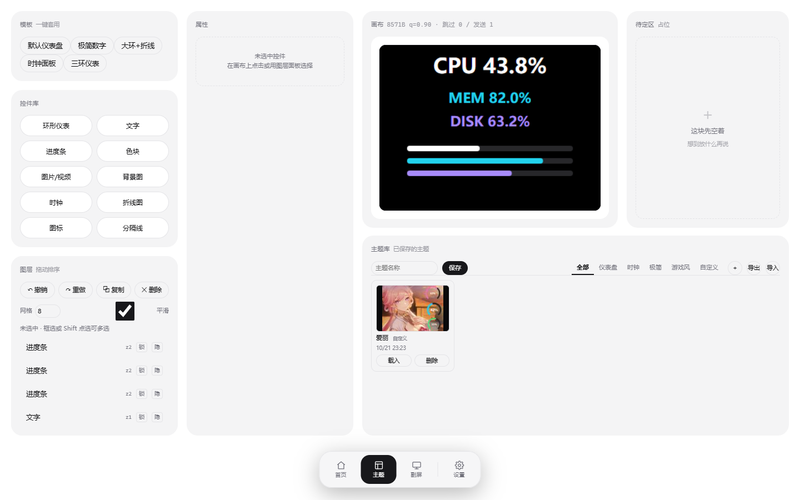
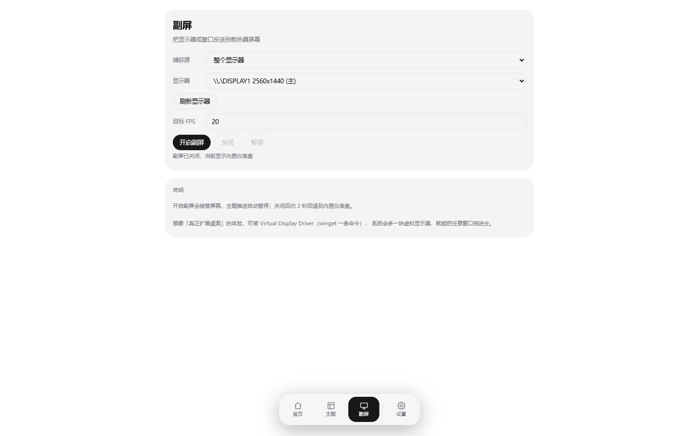
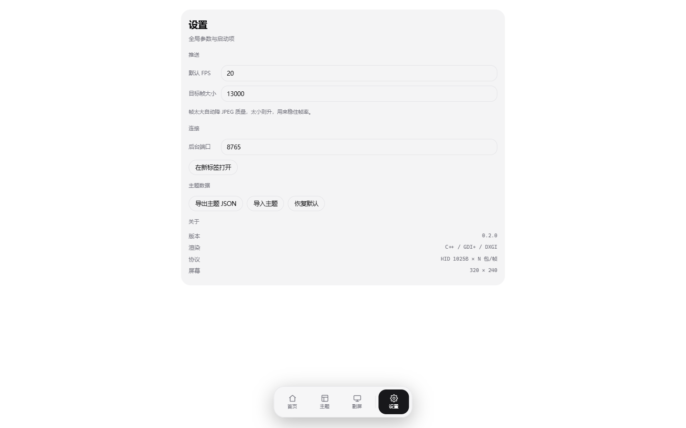

# Coolleo Studio

给 Coolleo（酷凛）散热器那块 **320×240 小屏** 做一套完全自由的动画 / 数据监控前端。
原厂软件只能换皮肤，这个版本把主题变成 **纯 JSON + 表达式**，屏幕上想显示什么由你决定。

> 单个 590 KB 的 exe，零运行时依赖，不装驱动、不装 Qt、不装 WebView2。
> 界面跑在你自己的浏览器里，谁都能改。



---

## 截图

| 主题编辑 | 窗口投送 |
|---|---|
|  |  |

| 设置 | 首页 |
|---|---|
|  |  |

---

## 为什么重写

原厂 `Coolleo_Center_Lite` 是一套 Qt + QtWebEngine 的应用：
9 个进程、389 MB 常驻、188 个线程，界面和渲染管线硬编码，想加个新表盘只能等官方更新。

| | 原 Coolleo_Center_Lite | Coolleo Studio |
|---|---|---|
| 进程 / 线程 | 9 进程 / 188 线程 | **1 进程 / 11 线程** |
| 常驻内存 | 389 MB（私有 657 MB） | **26–30 MB（私有 5–9 MB）** |
| 空闲 CPU | 6.2% | **0.6%** |
| 安装体积 | ≈180 MB（Qt + ffmpeg + Chromium） | **590 KB + 一个 html** |
| 界面技术 | 内嵌 QtWebEngine | 你机器上的浏览器（`127.0.0.1`） |
| 主题 | 官方加密的 `.mPanelTheme` 包 | **明文 JSON，可手写、可分享** |
| 加一个控件 | 改 QML、重新编译 | 在编辑器里拖一个 |
| 浏览器关掉后 | — | **后端继续按主题自己渲染** |

---

## 功能

### 主题编辑器

- 画布 **320×240**，等比例预览，所见即所得
- **11 类控件**：环形仪表、文字、进度条、色块、图片、视频、背景图层、时钟、折线图、图标、分隔线
- 拖拽 / 缩放 / 六向对齐 / 层级 / 吸附网格（0–40px 可调）/ 多选批量改属性
- 撤销重做、复制粘贴、方向键微调、右键菜单（锁定 / 隐藏 / 成组 / 置顶置底）
- **表达式绑定**：`${cpu.load | round(0)}`、`${mem.usedGB | clamp(0,32)}GB`
- **阈值预警**：超过警戒值 / 危险值自动换色（弧、条、文字都吃）
- **条件显隐**：`cpu.load > 80`、`cpu.temp >= 70 && gpu.load < 50`
- **数值平滑**：跳变的采样值缓动到目标，指针不再抽搐
- 主题库：分类表项、缩略图、导入导出单文件主题包、覆盖保存

### 窗口投送

把**某一个窗口**实时投到小屏（`PrintWindow`，不抓整个屏幕 —— 320×240 上整屏缩下来什么都看不清）。
最高 20 fps，静止画面自动跳过（实测省 96% 带宽）。

选过的窗口会被记住：下次启动如果它还在运行，自动接着投送；窗口关掉自动停下。

### 后端渲染

浏览器一关，屏幕不会黑：后端用 GDI+ 按同一份主题 JSON 继续画，指标继续刷新。
浏览器重新打开会自动从后端取回当前主题，状态不丢。

### 其它

- 托盘常驻，双击打开界面；开机自启（`HKCU\...\Run`，可关）
- 启动后自动连接设备，不用点按钮
- 多标签页自动选举，只有一个标签往设备推帧，不会打架

---

## 快速开始

### 用现成的

1. 从 [Releases](../../releases) 下载 `coolleo-studio-v1.0.0.zip`
2. 解压到任意目录
3. 双击 `coolleo-svc.exe` → 托盘出现图标，浏览器自动打开界面

> 如果你装了原厂软件，先把 `Coolleo_Center_Lite.exe` 退掉 —— HID 设备是独占的。

### 自己编译

需要 **Visual Studio 2019 / 2022 的 C++ 生成工具**（或 Build Tools）。

```bat
git clone https://github.com/<you>/coolleo-studio.git
cd coolleo-studio\native
build.bat
```

产物在 `native\build\`：

```
coolleo-svc.exe     590 KB，单文件
ui\index.html       界面（必须和 exe 同级的 ui\ 目录）
themes\             保存的主题
```

依赖全部 vendored，不联网也能编：`mongoose`（HTTP/WS 服务）、`nlohmann/json`。

---

## 主题格式

主题就是一个 JSON。最小例子：

```json
{
  "name": "我的表盘",
  "canvas": { "width": 320, "height": 240, "fps": 20, "background": "#000000" },
  "widgets": [
    {
      "id": "w1", "type": "arcGauge",
      "rect": { "x": 20, "y": 20, "w": 120, "h": 120 }, "z": 2,
      "props": { "label": "CPU", "arcColor": "#22d3ee", "thickness": 10,
                 "thWarn": 70, "thWarnColor": "#f59e0b",
                 "thDanger": 90, "thDangerColor": "#ef4444" },
      "bindings": { "value": "cpu.load" }
    },
    {
      "id": "w2", "type": "text",
      "rect": { "x": 20, "y": 160, "w": 200, "h": 40 }, "z": 3,
      "props": { "template": "${cpu.temp | round(0)}°C", "color": "#ffffff",
                 "font": "bold 28px Consolas", "align": "left" },
      "bindings": {},
      "visibleWhen": "cpu.load > 50"
    }
  ]
}
```

字段说明见 [docs/THEME-FORMAT.md](docs/THEME-FORMAT.md)，完整示例见 [examples/dashboard.json](examples/dashboard.json)。

### 可用指标

| 键 | 说明 | 键 | 说明 |
|---|---|---|---|
| `cpu.load` | CPU 占用 % | `disk.usedPercent` | 磁盘占用 % |
| `cpu.temp` | CPU 温度 ℃\* | `disk.freeGB` | 磁盘剩余 GB |
| `gpu.load` | GPU 占用 %\* | `disk.totalGB` | 磁盘总量 GB |
| `gpu.temp` | GPU 温度 ℃\* | `net.recvTotal` | 网络下行 |
| `mem.usedPercent` | 内存占用 % | `net.sendTotal` | 网络上行 |
| `mem.usedGB` / `mem.totalGB` | 内存已用 / 总量 | | |

\* 需要本机装有 **LibreHardwareMonitor** 或 **HWiNFO64** 提供 WMI 数据；没有时恒为 0。

---

## 架构

```
coolleo-svc.exe
├─ 托盘 / 开机自启
├─ HTTP 服务（mongoose，127.0.0.1:8765）
│   └─ ui/index.html   ← 你的浏览器打开它
├─ HID 写帧线程       1025 字节报告 / 20 fps 上限
├─ 渲染循环          优先级：网页推帧 > 窗口投送 > 后端画主题 > 内置仪表盘
└─ 指标采样           GetSystemTimes / GlobalMemoryStatusEx / GetIfTable（900ms 节流 + EMA）
```

数据流很短：**采样 → 渲染（浏览器或后端二选一）→ JPEG 240×320 → 拆包 → HID**。

画面在浏览器里由 `<canvas>` 画，`toDataURL('image/jpeg')` 出图后 POST 给后端；
浏览器不在时，后端用 GDI+ 把同一份 JSON 画成同样的图。

---

## 协议

设备是标准 HID，**不需要任何驱动**（Microsoft 的 `input.inf` + `HidUsb.sys` 就够）：

```
VID 0x1600 / PID 0x3006
输出报告 1025 字节 = 1 字节 ReportID + 1024 字节数据
一帧 = 1 个头包 + N 个数据包
  头包   [0]=0x00  [1..3]="CRT"  [6..8]="DRA"
         [9..12]=JPEG长度+32 (大端 u32)  [13]=0xB1  [14..21]=时间戳
         [33..] = JPEG 前 992 字节
  数据包 [1..1024] = 后续 JPEG
```

其它命令：`HAN`（握手）、`CRT\0\0VER`、`DIS`、`STP`、`CLE`。

完整抓包、反汇编与验证记录在 [docs/PROTOCOL.md](docs/PROTOCOL.md)。

---

## 已知限制

- **上限 20 fps**，是 HID 中断传输带宽决定的，软件层面绕不过
- **亮度控制未破解**（命令未知，接口直接返回不支持，避免把设备写复位）
- **CPU/GPU 温度**依赖第三方 WMI 提供者，本程序不读 MSR、不装驱动
- **官方 `.mPanelTheme` 只能导入布局与图片**：内置 mp4 是逐 NAL 加密的，密钥不在文件里，
  也不走 OpenSSL（已用 Frida 逐层验证），视频需自己准备素材
- 主题 JSON 目前存在**内存**里，重启服务回到「最后一帧」；点保存才会落盘
- 只在 **Windows 10/11 x64** + 该型号设备上验证过

---

## 致谢

- [mongoose](https://github.com/cesanta/mongoose) —— 单文件 HTTP 服务
- [nlohmann/json](https://github.com/nlohmann/json) —— 单头文件 JSON
- [shadcn/ui](https://ui.shadcn.com/) —— 界面配色与形状的参考

## 许可

[MIT](LICENSE)。原厂固件、官方主题包与素材版权归原厂所有，本仓库不含这些内容。
